# Diagram Sistem (PlantUML) — Tejas Coffee POS

Versi **PlantUML** dari diagram yang sama dengan [`DIAGRAM_SISTEM.md`](DIAGRAM_SISTEM.md).
Semua blok bisa di-copy langsung ke:

- <http://www.plantuml.com/plantuml/uml> (paste → Submit → PNG/SVG)
- VS Code (extension **PlantUML** / **PlantUML Preview**)
- IntelliJ / Eclipse / Confluence (plugin PlantUML)
- CLI: `java -jar plantuml.jar diagram.puml`

> Catatan render: PlantUML di sini diuji dengan **PlantUML 1.2024.8**. Untuk diagram
> entity (ERD & skema) butuh GraphViz; bila tidak ada, PlantUML otomatis memakai
> mesin layout bawaannya (Smetana) dengan tampilan sedikit berbeda.

Daftar isi:

1. [Use Case Diagram](#1-use-case-diagram)
2. [Activity Diagram per Peran](#2-activity-diagram-per-peran)
3. [Flowchart per Peran](#3-flowchart-per-peran)
4. [Sequence Diagram](#4-sequence-diagram)
5. [ERD](#5-erd)
6. [Skema Database](#6-skema-database)
7. [Alur Transaksi](#7-alur-transaksi)

---

## 1. Use Case Diagram

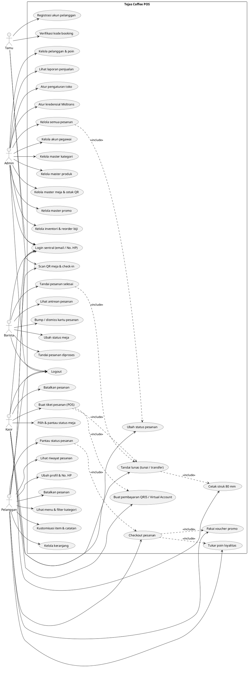

---

## 2. Activity Diagram per Peran

### 2.1 Activity — Login & Otorisasi (semua peran)

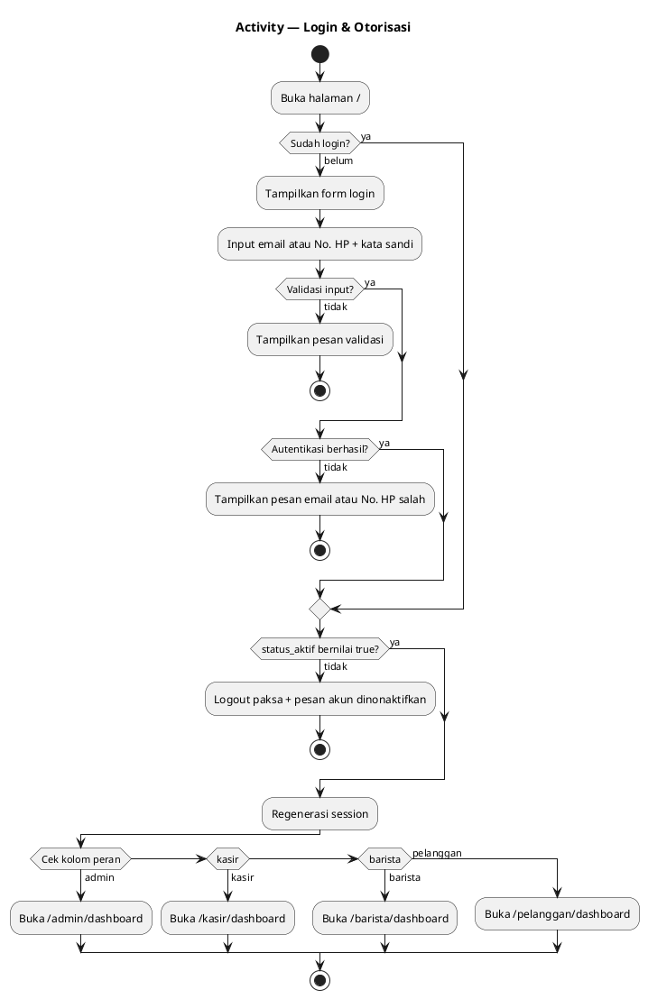

### 2.2 Activity — Pelanggan Memesan & Membayar

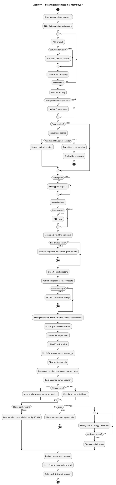

### 2.3 Activity — Pelanggan / Tamu Scan QR Meja

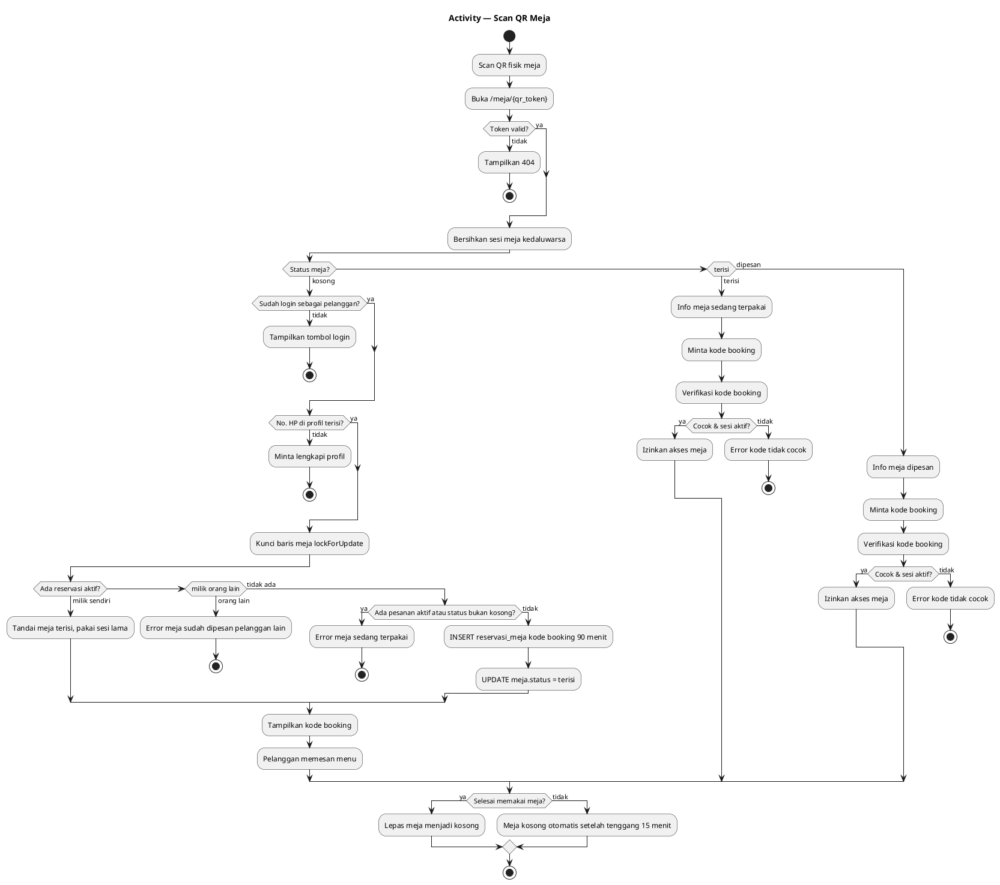

### 2.4 Activity — Kasir (POS)

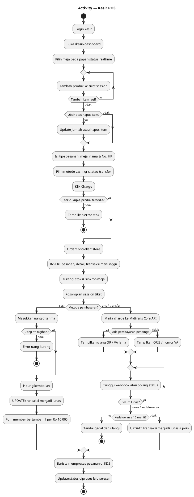

### 2.5 Activity — Barista (KDS)

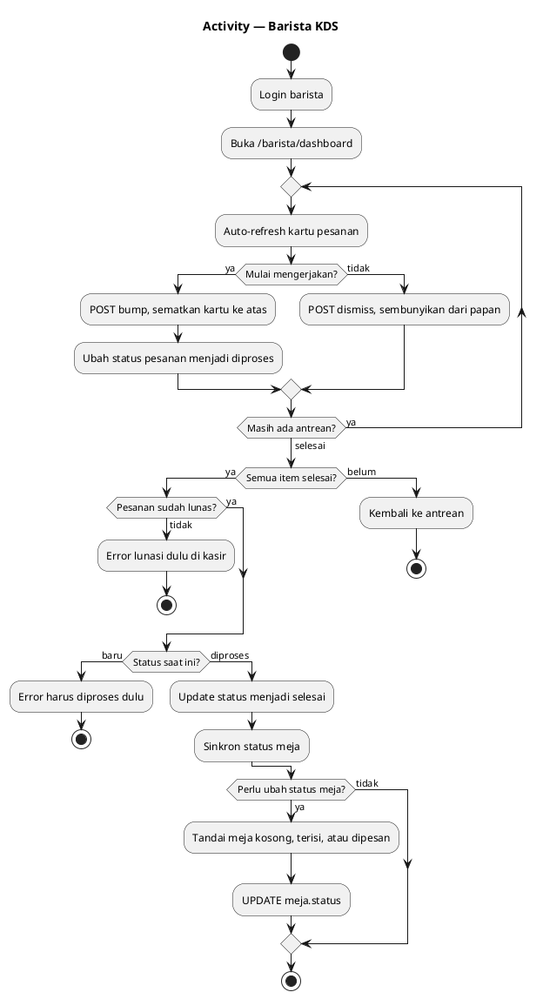

### 2.6 Activity — Admin

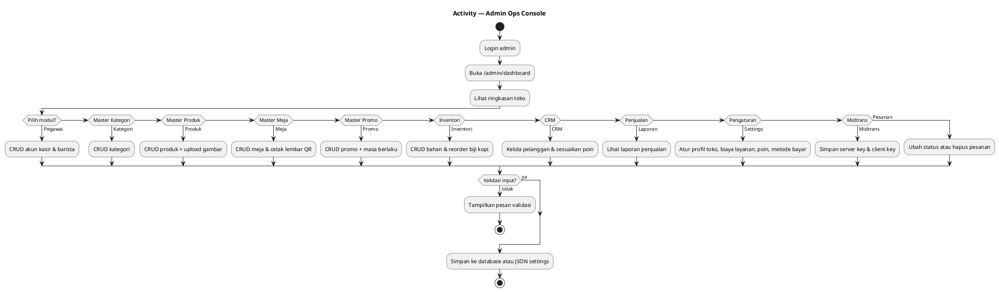

---

## 3. Flowchart per Peran

Flowchart di PlantUML digambar dengan sintaks activity (paling terbaca untuk alur
navigasi); bentuknya sama dengan versi Mermaid.

### 3.1 Flowchart Pelanggan

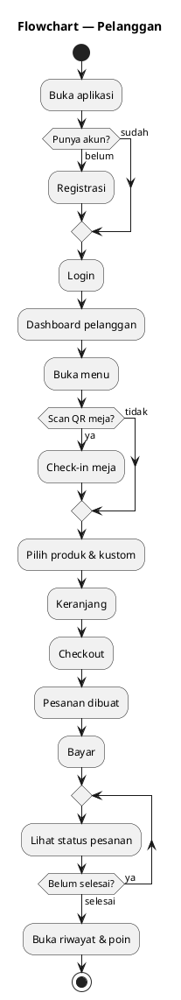

### 3.2 Flowchart Kasir

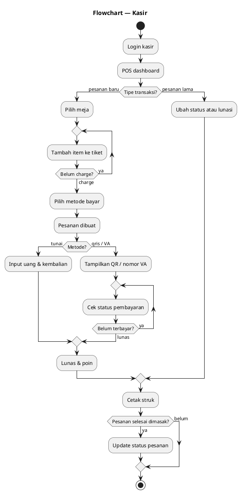

### 3.3 Flowchart Barista

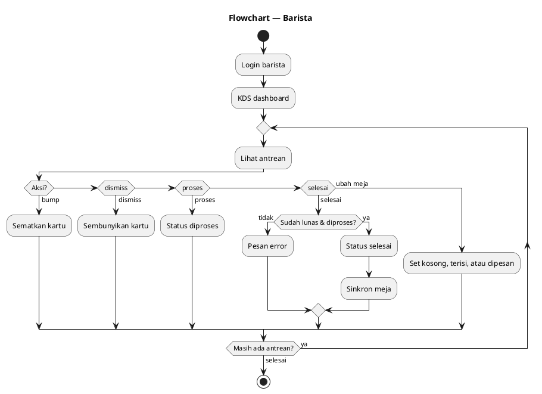

### 3.4 Flowchart Admin

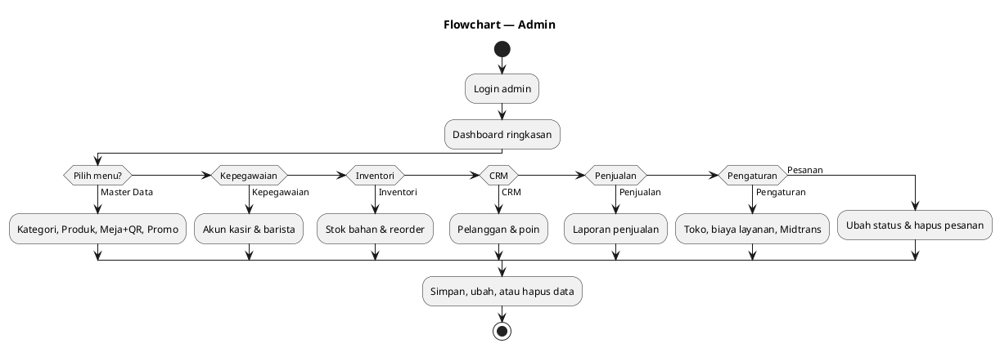

### 3.5 Flowchart Tamu (tanpa akun)

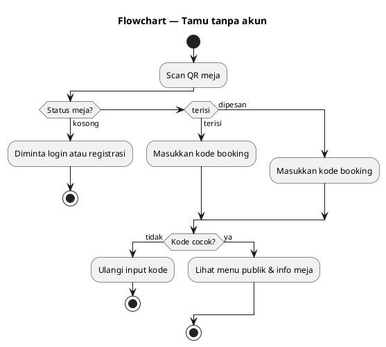

---

## 4. Sequence Diagram

### 4.1 Sequence — Login & RBAC

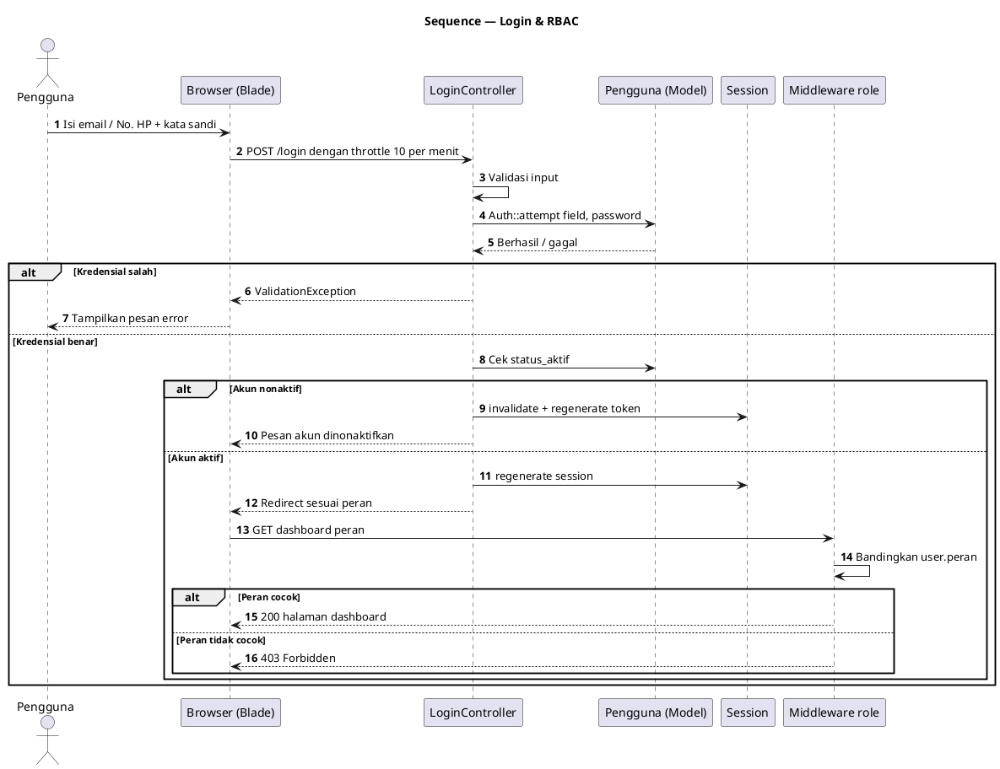

### 4.2 Sequence — Checkout Pelanggan

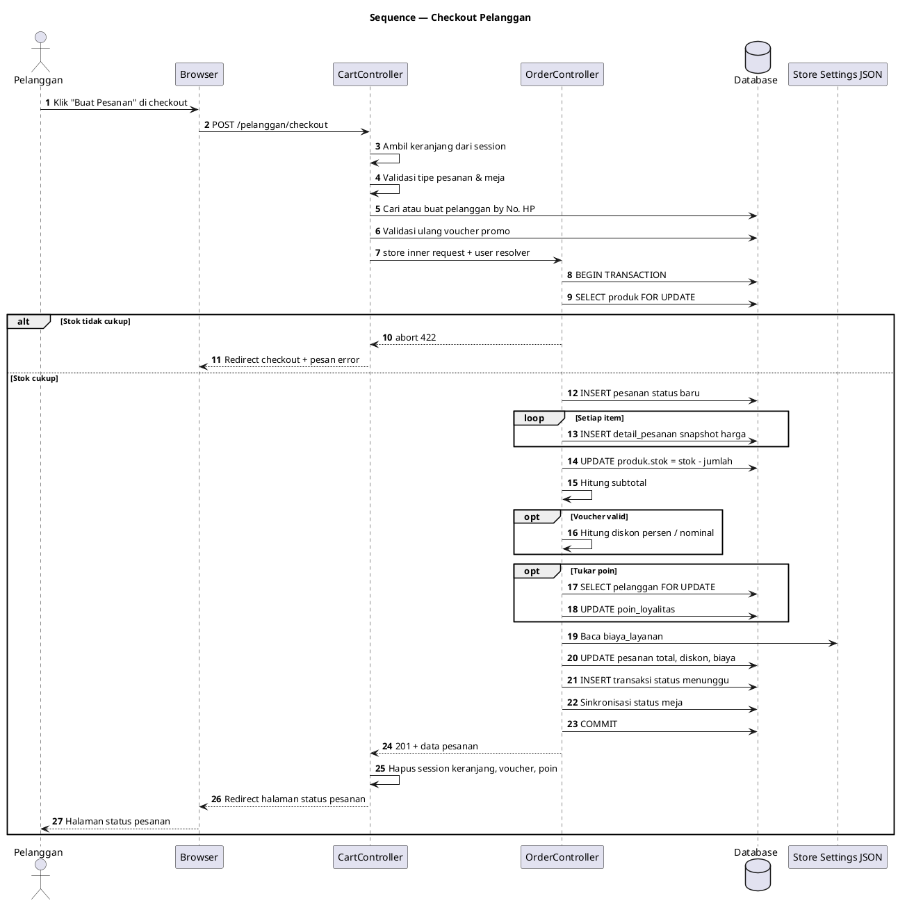

### 4.3 Sequence — Pembayaran QRIS Midtrans & Webhook

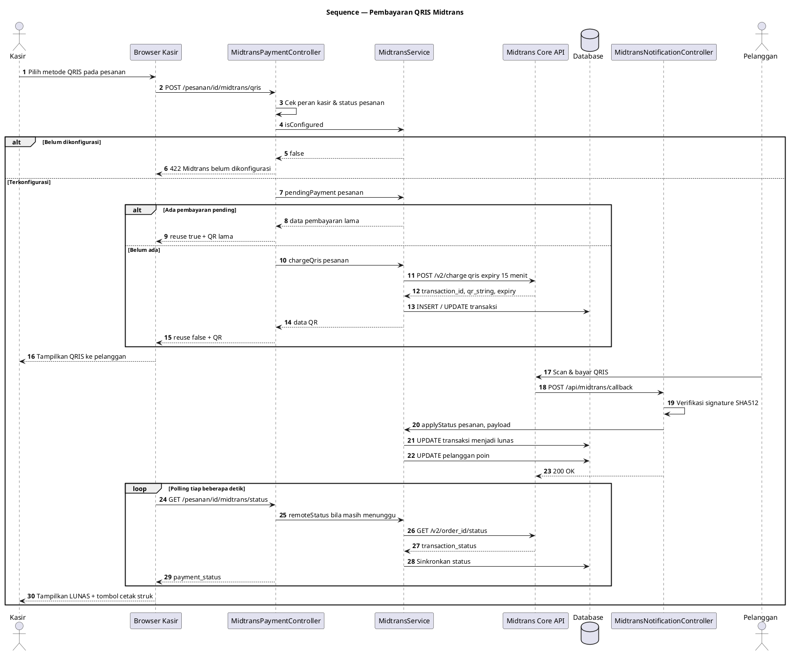

### 4.4 Sequence — Check-in Meja via QR

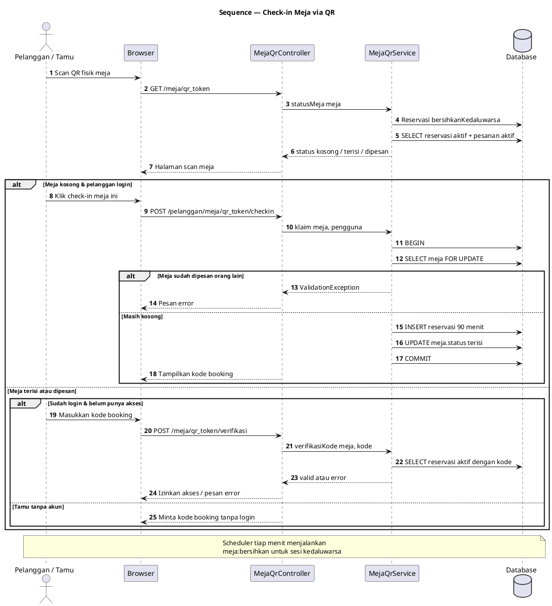

### 4.5 Sequence — Kasir Melunasi Tunai

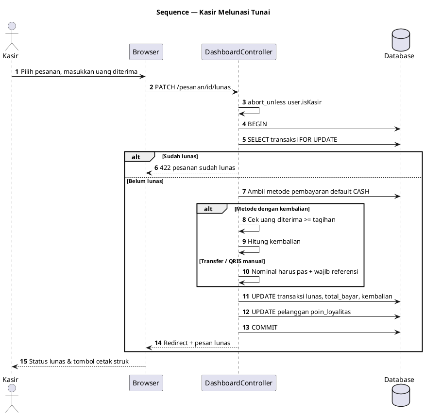

---

## 5. ERD

```plantuml
@startuml
title ERD — Tejas Coffee POS
hide circle
skinparam linetype ortho

entity "pengguna" as pengguna {
  * id_pengguna : bigint PK
  --
  nama_lengkap : varchar
  email : varchar UK
  kata_sandi : varchar
  nomor_telepon : varchar
  peran : enum
  status_aktif : boolean
  dibuat_pada : timestamp
}

entity "pelanggan" as pelanggan {
  * id_pelanggan : bigint PK
  --
  nama_pelanggan : varchar
  nomor_telepon : varchar
  poin_loyalitas : int
  terdaftar_pada : timestamp
}

entity "kategori" as kategori {
  * id_kategori : bigint PK
  --
  nama_kategori : varchar
  deskripsi : varchar
  status_aktif : boolean
}

entity "produk" as produk {
  * id_produk : bigint PK
  --
  id_kategori : bigint FK
  kode_produk : varchar UK
  nama_produk : varchar
  deskripsi : text
  harga : decimal
  stok : int
  status_tersedia : boolean
  url_gambar : varchar
}

entity "meja" as meja {
  * id_meja : bigint PK
  --
  nomor_meja : varchar UK
  kapasitas : int
  status : enum
  qr_token : varchar UK
}

entity "reservasi_meja" as reservasi_meja {
  * id_reservasi : bigint PK
  --
  id_meja : bigint FK
  id_pelanggan : bigint FK
  kode_booking : varchar UK
  status : enum
  dicek_in_pada : datetime
  berakhir_pada : datetime
  dibuat_pada : timestamp
}

entity "promo" as promo {
  * id_promo : bigint PK
  --
  kode_promo : varchar UK
  tipe_diskon : enum
  nilai_diskon : decimal
  berlaku_mulai : datetime
  berlaku_sampai : datetime
  status_aktif : boolean
}

entity "pesanan" as pesanan {
  * id_pesanan : bigint PK
  --
  nomor_pesanan : varchar UK
  id_pengguna : bigint FK
  id_pelanggan : bigint FK
  id_meja : bigint FK
  id_promo : bigint FK
  tipe_pesanan : enum
  status_pesanan : enum
  total_harga : decimal
  diskon : decimal
  poin_dipakai : int
  biaya_layanan : decimal
  catatan : text
  waktu_pesan : datetime
}

entity "detail_pesanan" as detail_pesanan {
  * id_detail : bigint PK
  --
  id_pesanan : bigint FK
  id_produk : bigint FK
  jumlah : int
  harga_satuan : decimal
  subtotal : decimal
  catatan_item : text
}

entity "metode_pembayaran" as metode_pembayaran {
  * id_metode : bigint PK
  --
  kode_metode : varchar UK
  nama_metode : varchar
  ada_kembalian : boolean
}

entity "transaksi" as transaksi {
  * id_transaksi : bigint PK
  --
  id_pesanan : bigint FK
  id_metode : bigint FK
  subtotal : decimal
  total_bayar : decimal
  kembalian : decimal
  bank_atau_ewallet : varchar
  nomor_referensi : varchar
  status_pembayaran : enum
  waktu_pembayaran : datetime
  midtrans_order_id : varchar UK
  midtrans_payment_type : varchar
  midtrans_payload : json
  midtrans_expires_at : datetime
}

entity "stok_biji" as stok_biji {
  * id_stok_biji : bigint PK
  --
  nama_biji : varchar
  kategori : varchar
  satuan : varchar
  deskripsi : varchar
  sisa_kg : decimal
  threshold_kg : decimal
  safety_cap_kg : decimal
  laju_konsumsi_kg_per_jam : decimal
  created_at : timestamp
  updated_at : timestamp
}

entity "log_reorder" as log_reorder {
  * id_log_reorder : bigint PK
  --
  id_stok_biji : bigint FK
  destination : varchar
  order_quantity_kg : decimal
  status : enum
  response_reference : varchar
  waktu_dispatch : datetime
}

entity "midtrans_settings" as midtrans_settings {
  * id : bigint PK
  --
  server_key : varchar
  client_key : varchar
  is_production : boolean
  webhook_verified : varchar
  created_at : timestamp
  updated_at : timestamp
}

pengguna ||--o{ pesanan : menangani
pelanggan o|--o{ pesanan : memesan
meja o|--o{ pesanan : dipakai
promo o|--o{ pesanan : diskon
pesanan ||--|{ detail_pesanan : berisi
produk ||--o{ detail_pesanan : dipesan
kategori ||--o{ produk : mengelompokkan
pesanan ||--|| transaksi : dibayar
metode_pembayaran ||--o{ transaksi : metode
meja ||--o{ reservasi_meja : sesi
pelanggan o|--o{ reservasi_meja : checkin
stok_biji ||--o{ log_reorder : reorder
@enduml
```

---

## 6. Skema Database

### 6.1 Peta relasi

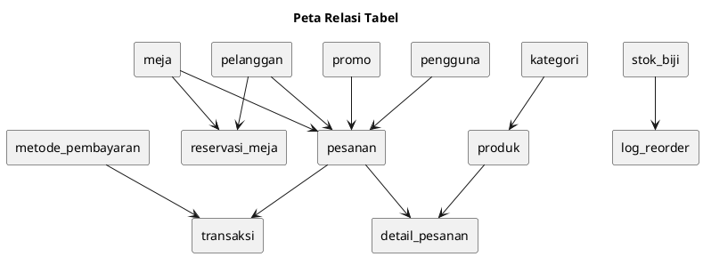

### 6.2 Kamus tabel

Kamus kolom lengkap (tipe, NOT NULL, default, foreign key, index) sama persis dengan
versi Mermaid di [`DIAGRAM_SISTEM.md` §6.2](DIAGRAM_SISTEM.md#62-kamus-tabel), sehingga
tidak diduplikasi di sini agar tidak terjadi perbedaan data antar dokumen.

### 6.3 Skema lengkap (dengan tipe kolom)

```plantuml
@startuml
title Skema Database — kolom & tipe
hide circle
skinparam linetype ortho

entity "pengguna" as pengguna {
  * id_pengguna : bigint unsigned PK
  --
  nama_lengkap : varchar 255
  email : varchar 255 UK
  kata_sandi : varchar 255
  nomor_telepon : varchar 20
  peran : enum admin, kasir, barista, pelanggan
  status_aktif : boolean default true
  dibuat_pada : timestamp
}

entity "pelanggan" as pelanggan {
  * id_pelanggan : bigint unsigned PK
  --
  nama_pelanggan : varchar 255
  nomor_telepon : varchar 20
  poin_loyalitas : int unsigned default 0
  terdaftar_pada : timestamp
}

entity "kategori" as kategori {
  * id_kategori : bigint unsigned PK
  --
  nama_kategori : varchar 255
  deskripsi : varchar 255
  status_aktif : boolean default true
}

entity "produk" as produk {
  * id_produk : bigint unsigned PK
  --
  id_kategori : bigint unsigned FK
  kode_produk : varchar 255 UK
  nama_produk : varchar 255
  deskripsi : text
  harga : decimal 10 2
  stok : int unsigned default 0
  status_tersedia : boolean default true
  url_gambar : varchar 255
}

entity "meja" as meja {
  * id_meja : bigint unsigned PK
  --
  nomor_meja : varchar 255 UK
  kapasitas : int unsigned
  status : enum kosong, terisi, dipesan
  qr_token : varchar 64 UK
}

entity "reservasi_meja" as reservasi_meja {
  * id_reservasi : bigint unsigned PK
  --
  id_meja : bigint unsigned FK
  id_pelanggan : bigint unsigned FK
  kode_booking : varchar 12 UK
  status : enum aktif, selesai, kedaluwarsa, dibatalkan
  dicek_in_pada : datetime
  berakhir_pada : datetime
  dibuat_pada : timestamp
}

entity "promo" as promo {
  * id_promo : bigint unsigned PK
  --
  kode_promo : varchar 255 UK
  tipe_diskon : enum persen, nominal
  nilai_diskon : decimal 10 2
  berlaku_mulai : datetime
  berlaku_sampai : datetime
  status_aktif : boolean default true
}

entity "pesanan" as pesanan {
  * id_pesanan : bigint unsigned PK
  --
  nomor_pesanan : varchar 255 UK
  id_pengguna : bigint unsigned FK
  id_pelanggan : bigint unsigned FK
  id_meja : bigint unsigned FK
  id_promo : bigint unsigned FK
  tipe_pesanan : enum dine-in, takeaway, delivery
  status_pesanan : enum baru, diproses, selesai, dibatalkan
  total_harga : decimal 12 2
  diskon : decimal 12 2 default 0
  poin_dipakai : int unsigned default 0
  biaya_layanan : decimal 12 2 default 0
  catatan : text
  waktu_pesan : datetime
}

entity "detail_pesanan" as detail_pesanan {
  * id_detail : bigint unsigned PK
  --
  id_pesanan : bigint unsigned FK
  id_produk : bigint unsigned FK
  jumlah : int unsigned default 1
  harga_satuan : decimal 10 2
  subtotal : decimal 12 2
  catatan_item : text
}

entity "metode_pembayaran" as metode_pembayaran {
  * id_metode : bigint unsigned PK
  --
  kode_metode : varchar 255 UK
  nama_metode : varchar 255
  ada_kembalian : boolean default false
}

entity "transaksi" as transaksi {
  * id_transaksi : bigint unsigned PK
  --
  id_pesanan : bigint unsigned FK UK
  id_metode : bigint unsigned FK
  subtotal : decimal 12 2
  total_bayar : decimal 12 2
  kembalian : decimal 12 2 default 0
  bank_atau_ewallet : varchar 255
  nomor_referensi : varchar 255
  status_pembayaran : enum menunggu, lunas, gagal
  waktu_pembayaran : datetime
  midtrans_order_id : varchar 80 UK
  midtrans_payment_type : varchar 40
  midtrans_payload : json
  midtrans_expires_at : datetime
}

entity "stok_biji" as stok_biji {
  * id_stok_biji : bigint unsigned PK
  --
  nama_biji : varchar 255
  kategori : varchar 255 default Biji Kopi
  satuan : varchar 20 default kg
  deskripsi : varchar 255
  sisa_kg : decimal 8 2
  threshold_kg : decimal 8 2
  safety_cap_kg : decimal 8 2
  laju_konsumsi_kg_per_jam : decimal 8 4
  created_at : timestamp
  updated_at : timestamp
}

entity "log_reorder" as log_reorder {
  * id_log_reorder : bigint unsigned PK
  --
  id_stok_biji : bigint unsigned FK
  destination : varchar 255
  order_quantity_kg : decimal 8 2
  status : enum terkirim, gagal
  response_reference : varchar 255
  waktu_dispatch : datetime
}

entity "midtrans_settings" as midtrans_settings {
  * id : bigint unsigned PK
  --
  server_key : varchar 255
  client_key : varchar 255
  is_production : boolean default false
  webhook_verified : varchar 255 default pending
  created_at : timestamp
  updated_at : timestamp
}

pengguna ||--o{ pesanan
pelanggan o|--o{ pesanan
meja o|--o{ pesanan
promo o|--o{ pesanan
pesanan ||--|{ detail_pesanan
produk ||--o{ detail_pesanan
kategori ||--o{ produk
pesanan ||--|| transaksi
metode_pembayaran ||--o{ transaksi
meja ||--o{ reservasi_meja
pelanggan o|--o{ reservasi_meja
stok_biji ||--o{ log_reorder
@enduml
```

---

## 7. Alur Transaksi

### 7.1 State machine status pesanan

```plantuml
@startuml
title State — status_pesanan

[*] --> baru : Pesanan dibuat oleh pelanggan atau kasir
baru --> diproses : Barista / kasir mulai mengerjakan
baru --> dibatalkan : Dibatalkan, stok dikembalikan
diproses --> selesai : Serah terima
diproses --> dibatalkan : Dibatalkan, stok dikembalikan
selesai --> [*]
dibatalkan --> [*]

note right of baru
  Mengikuti Pesanan::TRANSISI_STATUS
  baru tidak boleh langsung selesai
  diproses tidak boleh mundur ke baru
end note
@enduml
```

### 7.2 State machine status pembayaran

```plantuml
@startuml
title State — status_pembayaran

[*] --> menunggu : Pesanan dibuat, transaksi otomatis
menunggu --> lunas : Kasir tandai lunas atau webhook Midtrans
menunggu --> gagal : QRIS atau VA kedaluwarsa
gagal --> menunggu : Kasir membuat charge ulang
lunas --> [*]

note right of lunas
  Saat lunas poin member bertambah
  floor total_harga / 10000
  Status pesanan tidak otomatis berubah
end note
@enduml
```

### 7.3 Alur uang, stok, dan poin

```plantuml
@startuml
title Alur — uang, stok, dan poin

start
:Pelanggan atau kasir membuat pesanan;
:OrderController::store;
:Kunci produk dengan lockForUpdate;
if (Stok cukup?) then (tidak)
  :HTTP 422, pesanan batal;
  stop
else (ya)
endif

:Kurangi stok;
:Simpan pesanan + detail;
:Hitung subtotal - voucher - poin + biaya layanan;
:Transaksi menunggu dengan total_bayar 0;

if (Metode bayar?) then (tunai)
  :Kasir input uang diterima;
  if (Uang >= tagihan?) then (tidak)
    :Tolak, minta nominal cukup;
    stop
  else (ya)
    :total_bayar = uang, kembalian = selisih;
  endif
else (QRIS / VA)
  :Midtrans charge dengan masa berlaku 15 menit;
  if (Status gateway?) then (settlement)
    :total_bayar = gross_amount;
  elseif (expire atau deny) then (gagal)
    :status gagal, boleh charge ulang;
    stop
  else (pending)
    :Tunggu webhook atau polling;
    stop
  endif
endif

:status_pembayaran = lunas;
:Poin member bertambah 1 per Rp 10.000;
:Barista memproses di KDS;
:Pesanan selesai;
:Struk 80 mm dicetak;
stop
@enduml
```

### 7.4 Rincian pembentukan total

```plantuml
@startuml
title Perhitungan Total Pesanan

start
:Subtotal = jumlah seluruh harga_satuan x jumlah;
if (Pakai voucher?) then (persen)
  :diskon = subtotal x persen;
elseif (nominal) then (nominal)
  :diskon = min nilai nominal, subtotal;
else (tidak)
  :diskon voucher = 0;
endif

if (Pakai poin?) then (ya)
  :poin_dipakai = min saldo, floor total / 10;
  :diskon poin = poin x Rp 10;
else (tidak)
  :diskon poin = 0;
endif

:biaya_layanan dari Store Settings;
:total_harga = subtotal - diskon + biaya_layanan;
stop
@enduml
```

---

## Catatan

- Angka mengikuti implementasi saat ini:
  `Pesanan::RUPIAH_PER_POIN` = 10.000,
  `ReservasiMeja::DURASI_MENIT` = 90,
  `ReservasiMeja::TENGGANG_MENIT` = 15,
  `ReservasiMeja::MAKS_SESI_MENIT` = 180,
  `MidtransService::EXPIRY_MINUTES` = 15.
- Diagram alur (activity/flowchart) memakai sintaks *activity beta* PlantUML, bukan
  bentuk UML activity formal dengan swimlane; strukturnya sama dengan versi Mermaid.
