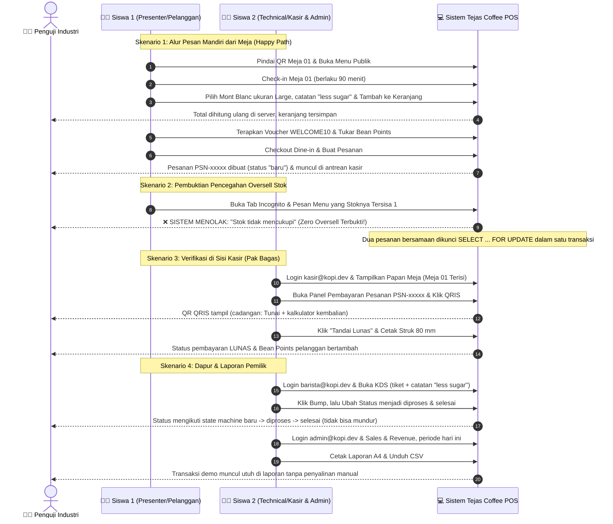

### 7. S4-07: PROTOKOL GLADI BERSIH & LIVE DEMO APP (10 MENIT)

Saat mendemonstrasikan aplikasi di hadapan asesor industri, dilarang berpindah-pindah layar tanpa alur cerita. Gunakan skenario peran nyata (_role-playing scenario_):

Alokasi 10 menit untuk Skenario 1–4 beserta perintah terminalnya ada di [`DEMO_SCRIPT.md`](DEMO_SCRIPT.md); halaman ini adalah protokol peran yang wajib diikuti saat gladi bersih maupun saat ujian.
