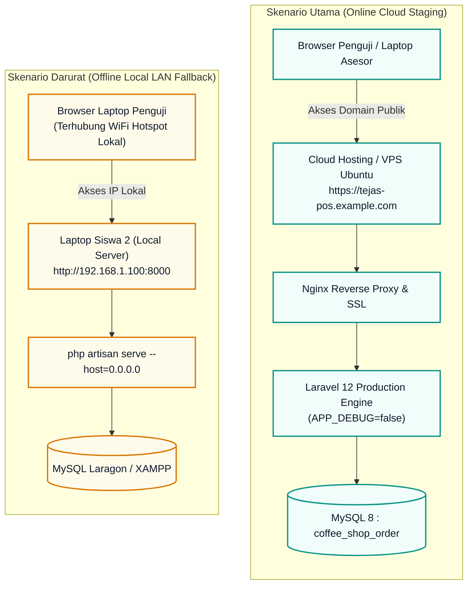

### 2. S4-02: ARTEFAK PRODUCTION DEPLOYMENT & OFFLINE CONTINGENCY



*Domain staging menyesuaikan hosting yang digunakan pada saat pelaksanaan.*


#### Skrip Peluncur Darurat Offline LAN (Windows Batch Script): serve-lan.bat

Letakkan skrip ini di folder `docs/08-deployment/` proyek untuk mengantisipasi jaringan internet putus saat ujian:

```bat
@echo off
title PELUNCUR SERVER DARURAT OFFLINE UKK RPL - TEJAS COFFEE POS
color 0A

echo ==============================================================
echo MEMULAI SERVER LOKAL TEJAS COFFEE POS (MODE KONTINJENSI OFFLINE)
echo ==============================================================
echo.
echo Pastikan Laragon / XAMPP (MySQL) telah aktif pada port 3306!
echo Mendeteksi alamat IP lokal laptop ini...

for /f "tokens=4" %%a in ('route print ^| findstr 0.0.0.0.*0.0.0.0') do set IP=%%a

echo Alamat IP Server Anda: http://%IP%:8000
echo.
echo [1/3] Membersihkan Cache Sistem...
php artisan config:clear
php artisan route:clear
echo.
echo [2/3] Membuka Akses Storage Symlink...
php artisan storage:link
echo.
echo [3/3] Menjalankan Server Web Terbuka ke Seluruh Jaringan...
echo Silakan minta penguji membuka browser: http://%IP%:8000
echo Tekan CTRL + C untuk menghentikan server.
echo ==============================================================

php artisan serve --host 0.0.0.0 --port 8000

pause
```
